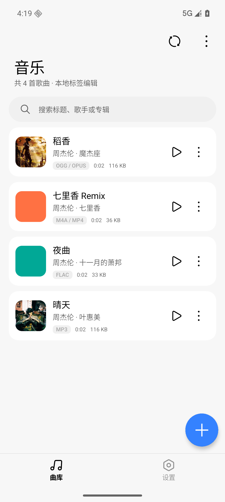
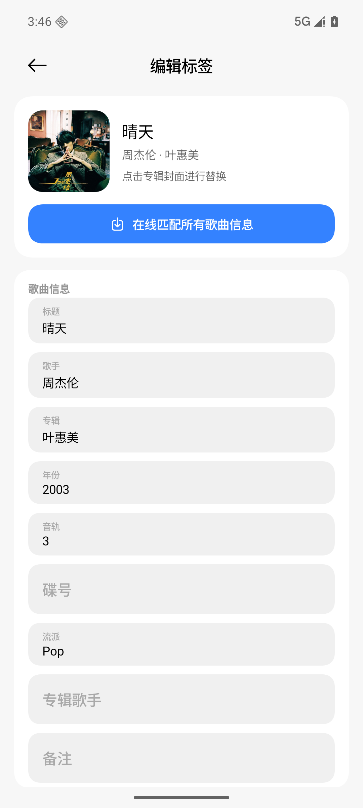
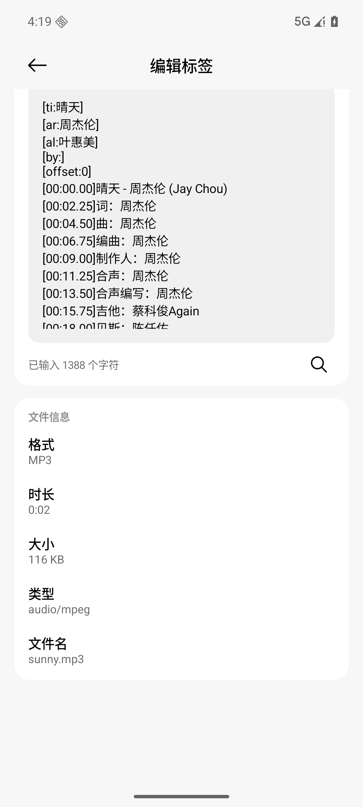
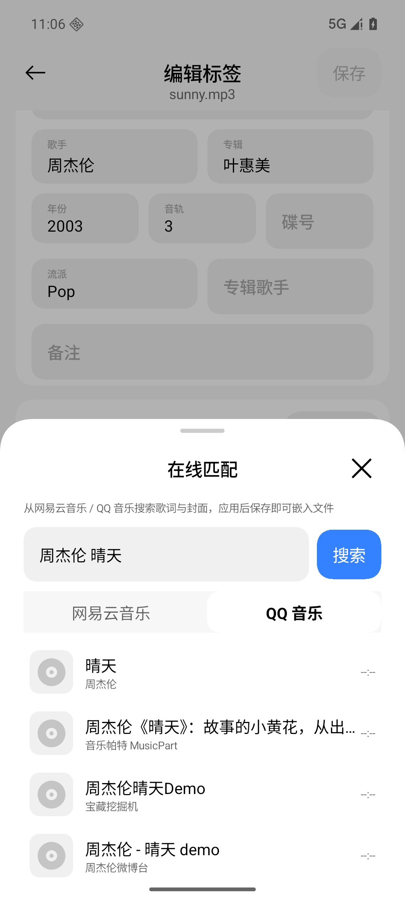
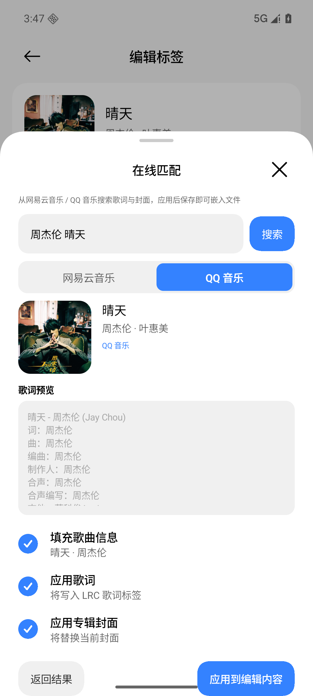
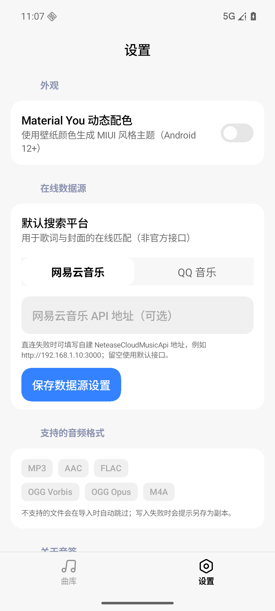

# 音签 · MusicTagger

一个 **MIUI / HyperOS 风格**（基于 [MiuiX](https://github.com/compose-miuix-ui/miuix)）的 Android
本地音乐标签编辑器：选择本地音频文件，编辑歌曲名、歌手、专辑、年份、音轨、流派、歌词与专辑封面，
并把修改直接写回文件；歌词和封面可以从 **网易云音乐 / QQ 音乐** 在线搜索匹配后嵌入。

> 所有音频与图片只在本机处理，不上传任何文件。在线功能仅查询公开的歌词 / 封面信息。

## 界面预览

| 曲库 | 编辑标签 | 歌词与文件信息 |
|---|---|---|
|  |  |  |

| 在线搜索 | 匹配预览 | 设置 |
|---|---|---|
|  |  |  |

Material You 动态取色（可选，从壁纸颜色生成 MIUI 风格主题）：`docs/screenshots/07-dynamic-color.png`

点击专辑封面弹出的替换方式选择：`docs/screenshots/08-cover-dialog.png`

应用图标（白底 + queue_music 线性图标，按黄金比例缩放）：`docs/screenshots/09-app-icon.png`

右上角「更多」菜单（白色圆角卡片 + 背景压暗，参照 KernelSU）：`docs/screenshots/10-menu.png`

点击卡片上的播放图标调起系统「选择打开方式」：`docs/screenshots/11-open-with.png`

## 功能

- **SAF 文件选择**：支持多选 `mp3 / flac / ogg / opus / m4a(mp4) / aac`，授予持久化访问权限，
  也可以从「所有文件」中导入；支持系统「打开方式 / 分享」直接进入编辑。
- **完整标签编辑**：标题、歌手、专辑、专辑歌手、年份、音轨、碟号、流派、备注、歌词、封面。
- **在线匹配**：
  - 网易云音乐：搜索、歌词（含翻译合并）、专辑封面，支持自建 `NeteaseCloudMusicApi` 地址。
  - QQ 音乐：搜索 → 歌曲详情 → 歌词与封面（`T002R500x500` 封面源）。
  - MIUI 底部面板中预览歌词 / 封面，用 MIUI 复选框选择要应用的内容后一键应用。
- **多格式标签引擎**（纯 Kotlin，无第三方库，完整单元测试 + ffmpeg 交叉验证）：
  - MP3：ID3v2.2/2.3/2.4 读，ID3v2.3/2.4 写（UTF-16/UTF-8 自适应）、APIC、USLT、ID3v1 处理；
    原始 ADTS `.aac` 的 ID3v2 头同样支持。
  - FLAC：Vorbis Comment + PICTURE（前置封面），保留 STREAMINFO / SEEKTABLE / APPLICATION 等块。
  - OGG Vorbis / Opus：注释包重分页（支持多页大歌词）、`METADATA_BLOCK_PICTURE` 封面、
    音频页原样保留、页序号与 CRC 重算。
  - M4A / MP4：`moov/udta/meta/ilst` 读写（©nam ©ART ©alb trkn disk covr 等），
    moov 尺寸变化时修正 `stco/co64` 偏移，兼容 faststart。
- **安全写入**：先写同目录临时文件、fsync、`ATOMIC_MOVE` 原子替换；源文件不可写时自动提示
  「另存为副本」。封面会自动缩放/重新编码，避免把几 MB 的原图塞进音频文件。
- **MIUI 设计**：参考 HyperOS / LSPosed 设置页的紧凑排版（更小字号、大标题 + 版本号、
  分组标题与卡片内文左对齐）、胶囊搜索框、底部导航、胶囊 FAB、右上角锚定的白色圆角菜单卡片、
  分组卡片、浮动标签输入框、蓝色填充分段控件、MIUI 开关 / 复选框 / 底部面板 / 对话框；
  保存动作是右下角胶囊扩展 FAB；点击封面可选择在线匹配 / 本地图片 / 移除；可选 Material You
  动态取色；深色模式跟随系统；应用图标为白底 queue_music 线性图标。

## 技术栈

| 层 | 实现 |
|---|---|
| UI | Jetpack Compose 1.10.3 + **MiuiX 0.9.0**（`miuix-ui` / `miuix-icons` / `miuix-preference`） |
| 架构 | 单 Activity + 手动依赖容器（无 Hilt）；ViewModel + StateFlow |
| 标签引擎 | 纯 JVM Kotlin 模块 `:core`，零第三方依赖，java.io/NIO 实现 |
| 网络 | `HttpURLConnection` + 自研 `MiniJson` 解析器（无 OkHttp / Retrofit） |
| 构建 | AGP 8.13.0 / Gradle 8.14.3 / Kotlin 2.3.20 / JDK 21，minSdk 26，targetSdk 36，compileSdk 37 |

> MiuiX 0.9.0 要求 `compileSdk 37`；AGP 8.13 官方最高支持 36，项目通过
> `android.suppressUnsupportedCompileSdk=37,37.0` 兼容编译。需要安装 Android SDK Platform 37
> （`sdkmanager "platforms;android-37.0" "build-tools;37.0.0"`）。

## 目录结构

```
MusicTagger/
├── app/                          # Android 应用（MIUI 风格 Compose UI）
│   └── src/main/java/com/musictag/app/
│       ├── data/                 # SAF I/O、仓库、封面解码、设置、网络图片加载
│       ├── ui/                   # 曲库 / 编辑 / 设置 / 在线匹配面板 / MIUI 主题
│       ├── AppContainer.kt       # 手动依赖容器
│       └── MainActivity.kt       # 单 Activity + 打开方式/分享入口
├── core/                         # 纯 JVM 标签与网络核心
│   ├── src/main/kotlin/com/musictag/core/tag/       # TagEditor + 四种格式实现
│   ├── src/main/kotlin/com/musictag/core/net/       # 网易云 / QQ 音乐 / HTTP / JSON / LRC
│   ├── src/test/kotlin/...                          # 单元测试（ffmpeg/ffprobe 交叉验证）
│   └── src/test/resources/fixtures/                 # 合成音频测试素材
├── tools/                        # 构建、模拟器、E2E 自动化脚本
├── docs/                         # 设计规格、MIUI API 速查、测试报告、截图
└── dist/                         # 交付 APK 与 SHA-256
```

## 构建

前置：JDK 17+（本机为 `D:\Java\jdk-21`）、Android SDK（`D:\Android\sdk`，API 36 + Platform 37）、
Gradle 8.14.3。项目路径包含中文，`tools/build.ps1` 会自动用 `subst` 映射一个 ASCII 盘符，
避免 Gradle 测试 worker 在非 ASCII 路径下的 classpath 编码问题。

```powershell
# 调试 APK
powershell -NoProfile -ExecutionPolicy Bypass -File tools\build.ps1 -Tasks ":app:assembleDebug"
# 全部单元测试
powershell -NoProfile -ExecutionPolicy Bypass -File tools\build.ps1 -Tasks ":core:test"
# 全部验证（构建 + 测试）
powershell -NoProfile -ExecutionPolicy Bypass -File tools\build.ps1 -Tasks ":core:test",":app:assembleDebug"
```

APK 输出：`app/build/outputs/apk/debug/app-debug.apk`（交付副本：`dist/MusicTagger-v1.0.0-debug.apk`，
SHA-256 见 `dist/SHA256.txt`）。

## 测试

- `core` 单元测试共 **154** 个：四种格式的读写/边界/损坏文件测试、外部 `ffprobe` 标签与
  封面校验、`ffmpeg` 解码校验；跨格式门面往返测试；网络源的 JSON 解析（录制真实响应）、
  LRC 工具、HTTP 错误映射。最近一次结果：154 tests / 0 failures（详见 `docs/TEST-REPORT.md`）。
- 端到端：在 API 36 模拟器上安装 APK，通过真实 UI 选择本地音乐 → 在线匹配网易云/QQ 音乐
  → 保存 → 用 Python `mutagen`、`ffprobe`、`ffmpeg` 独立校验写回结果
  （见 `tools/e2e/`，样例截图见 `docs/screenshots/`）。MIUI 版本已重新跑通曲库、编辑、
  在线匹配、保存、放弃修改对话框与动态取色全流程。

```powershell
# 生成并推送到模拟器的测试音频（含中文标签）
powershell -NoProfile -ExecutionPolicy Bypass -File tools\e2e\prepare-media.ps1
```

## 已知限制

- 网易云/QQ 音乐接口均为非官方公开接口，可能随服务端调整失效；不提供登录、下载音频、
  评论等能力，只读取搜索结果、歌词和专辑封面。可配置自建 NeteaseCloudMusicApi 作为回退。
- 封面写入为「单一前置封面」策略；`OGG` 中其它图片类型会被替换。
- 极少数特殊容器（分片 MP4 `moof`、链式/复用 OGG 流）不支持写入，会给出中文错误提示，
  不会破坏原文件。
- 写回只支持文件提供方允许写入的文档；只读文档会回退到「另存为新文件」。
- 标签写回始终重写整个文件（通过临时文件原子替换），超大文件的写入耗时与文件体积相当。
- MiuiX 仍处于实验阶段，升级其版本时需同步升级 Kotlin / Compose 工具链。

## 第三方与合规

- 应用不包含任何音频素材；测试素材由 ffmpeg 合成的正弦波生成。
- UI 库 [MiuiX](https://github.com/compose-miuix-ui/miuix) 以 Apache-2.0 许可发布。
- 在线歌词/封面版权归原平台与版权方所有，仅用于个人学习与本地标签整理。
