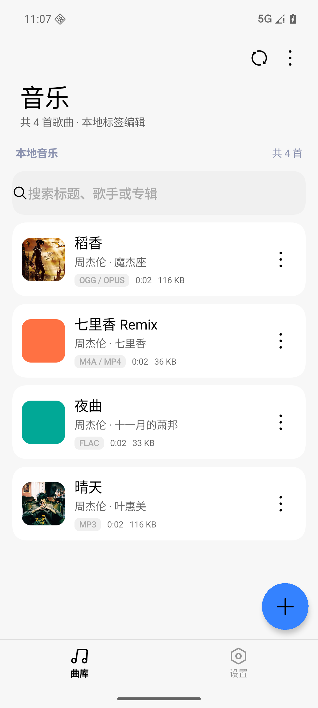
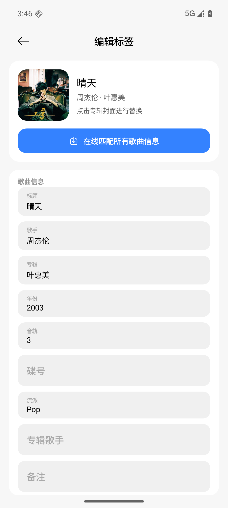
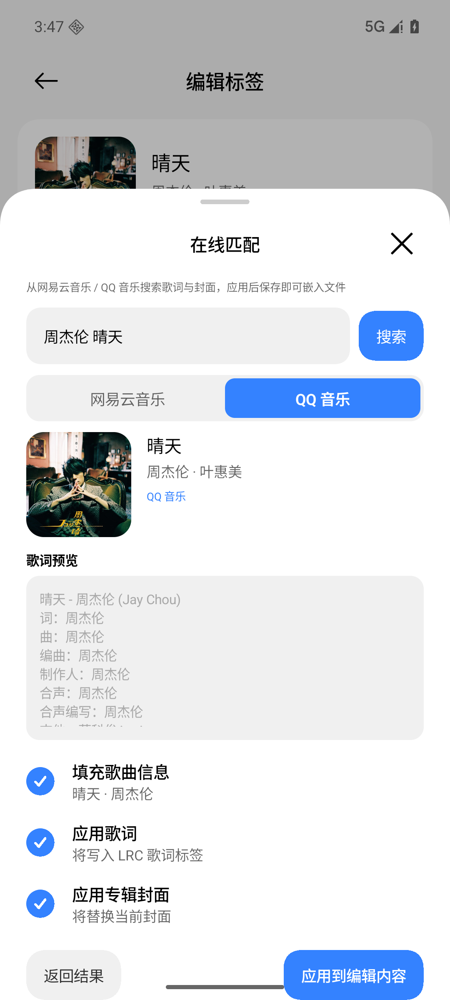
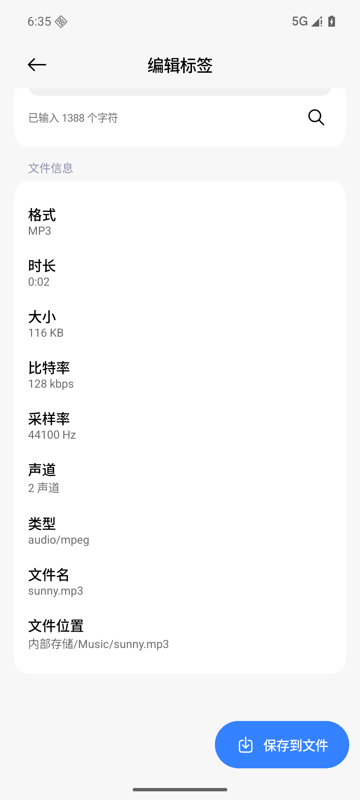
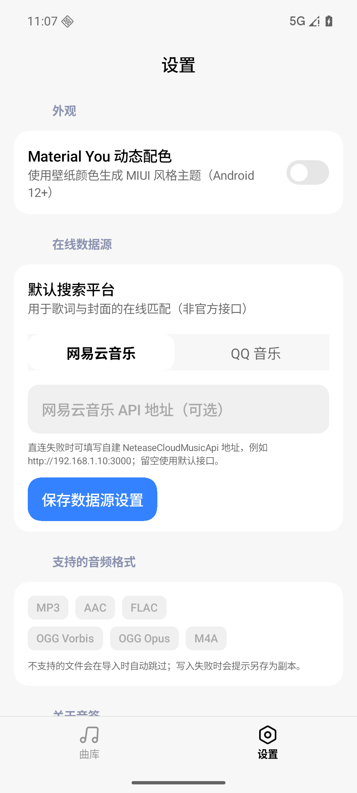
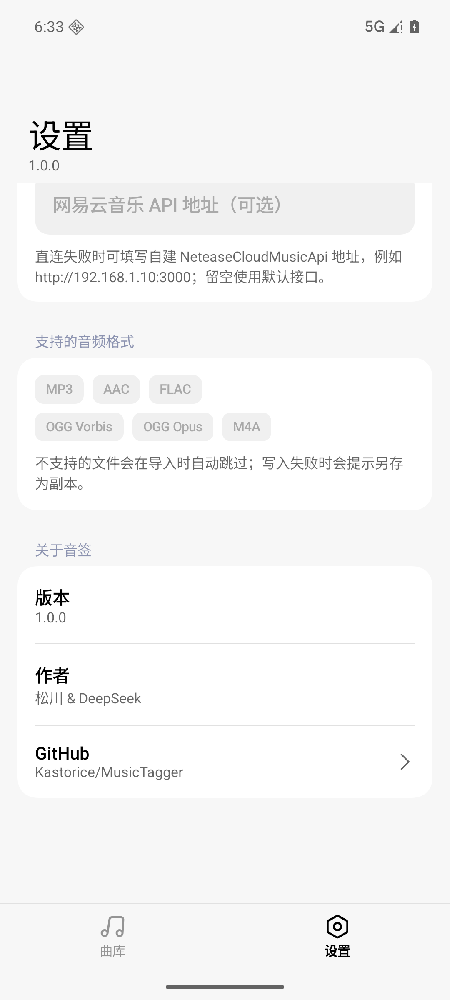

# 音签 MusicTagger v1.0.0

首个公开版本：**MIUI / HyperOS 风格的 Android 本地音乐标签编辑器**。

## 下载

- `MusicTagger-v1.0.0.apk`（debug 签名，约 19.4 MB）
- 校验：`SHA256.txt` 与 APK 一同发布（SHA-256：`B0D3D88DB1C24984036B0108699115273E5FF6A67378F8F41AD4B6B32A23353C`）
- 系统要求：Android 8.0（API 26）及以上；动态取色需 Android 12+
- 安装：下载 APK 后允许「安装未知来源应用」，或 `adb install MusicTagger-v1.0.0.apk`

## 截图

| 曲库 | 编辑标签 | 在线匹配 |
|---|---|---|
|  |  |  |

| 文件信息 | 设置 | 关于 |
|---|---|---|
|  |  |  |

## 功能

- 选择本地音频（mp3 / flac / ogg / opus / m4a / aac），编辑标题、歌手、专辑、专辑歌手、
  年份、音轨、碟号、流派、备注、歌词与专辑封面，并直接写回原文件。
- 网易云音乐 / QQ 音乐在线搜索歌词与封面，MIUI 底部面板预览并选择性应用。
- 纯 Kotlin 自研标签引擎：ID3v2（MP3/AAC）、Vorbis Comment（FLAC/OGG/Opus）、
  MP4 ilst，写入采用临时文件 + 原子替换，只读文件自动提示另存副本。
- MiuiX 界面：大标题顶栏、底部导航、分组卡片、胶囊搜索框、分段控件、扩展 FAB、
  原生风格菜单 / 对话框 / 底部面板；支持 Material You 动态取色。
- 曲库卡片播放入口（系统「选择打开方式」）、搜索过滤 / 取消、文件技术信息
  （比特率、采样率、声道、SAF 路径）、GitHub 链接等细节。

## 质量

- `:core` 共 154 个单元测试全部通过（四种格式读写、边界/损坏文件、网络源解析、
  跨格式门面往返、ffprobe/ffmpeg 外部交叉验证）。
- 在 API 36 模拟器上通过真实 UI 完成多格式端到端写入，并用 mutagen / ffmpeg 独立复核。

## 已知限制

- 网易云 / QQ 音乐接口为非官方公开接口，可能随服务端调整失效；可配置自建
  NeteaseCloudMusicApi 作为回退。
- 封面采用单一前置封面策略；少数特殊容器（分片 MP4、链式 OGG）不支持写入，会安全报错。
- 写回仅支持文件提供方允许写入的文档，否则回退为「另存为」。

## 开源

Apache License 2.0。欢迎在 <https://github.com/Kastorice/MusicTagger> 反馈问题或提交 PR。
